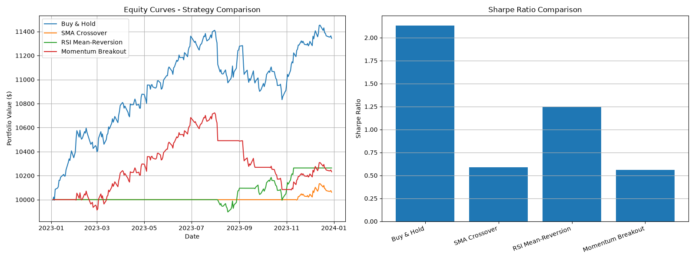

# Custom Backtesting Engine & Strategy Lab

A backtesting engine built from scratch in Python — no `backtrader`, no `zipline`, no `bt`. The point isn't to reinvent those libraries, it's to actually understand what a backtester is doing under the hood: order execution, position tracking, and the risk metrics everyone quotes without knowing how they're computed.

This is part of a 5-project, 5-month portfolio. Project 1 was a neural network from scratch; this one moves into quant finance.

## Status

Engine, four strategies, risk metrics (CAGR, Sharpe, Sortino, max drawdown, win rate), walk-forward testing, a comparison dashboard, packaging, and unit tests for the metrics are done. Still to do: testing on more than one ticker, tests for lookahead bias, a section on bias in this README, and a public write-up.

## A correction

Until Day 21, the SMA Crossover strategy was running with the wrong parameters. Its `prepare()` function had `slow_window` defaulting to 10 instead of 50, so the "slow" average was shorter than the "fast" one and the strategy was buying when price weakened and selling when it strengthened, close to the opposite of the trend-following rule it was supposed to be. Every SMA number published here before that, and several conclusions built on them, were wrong.

I found it because two strategies traded on the same day in 2020, and because SMA bought on a date when a 50-day average couldn't exist yet. After fixing the default I added a check that rejects `fast_window >= slow_window`. These were retracted:

- "SMA is nearly as risk-efficient as Buy & Hold" and "SMA edges Buy & Hold on Sortino" (the corrected SMA is well behind in 2023).
- "SMA gave real downside protection in 2022" (the corrected SMA had the worst Sharpe of the four that year).

Buy & Hold, RSI, and Momentum results were unaffected, since they don't use that file. The lesson I'm taking from it: results tables should not carry parameters typed by hand, and a parameter default is worth a test.

## Results

AAPL, $10,000 starting cash, $1 commission per trade, 0.1% slippage, 25% position sizing. SMA Crossover uses 20/50-day windows. RSI and Momentum use the defaults in their strategy files.

### 2023 only

| Strategy | Final Value | CAGR | Sharpe | Sortino | Max Drawdown | Trades | Win Rate |
|---|---|---|---|---|---|---|---|
| Buy & Hold | $11,343.23 | 13.68% | 2.13 | 3.31 | −5.07% | 1 | n/a |
| SMA Crossover | $10,061.97 | 0.63% | 0.59 | 0.99 | −0.71% | 1 | n/a |
| RSI Mean-Reversion | $10,263.94 | 2.68% | 1.25 | 1.92 | −1.87% | 4 | 100% (2 of 2) |
| Momentum Breakout | $10,232.34 | 2.36% | 0.56 | 0.83 | −5.99% | 7 | 33% (1 of 3) |

Win rate counts only closed round trips (a buy followed by its sell). Buy & Hold never sells, and SMA bought once in 2023 and never sold, so neither has a win rate.



### Walk-forward, 2020–2023 (each year run independently)

CAGR / Sharpe per year:

| Year | Buy & Hold | SMA Crossover | RSI Mean-Reversion | Momentum Breakout |
|---|---|---|---|---|
| 2020 | 19.3% / 1.45 | 16.7% / **1.84** | 0.1% / 0.05 | 13.0% / 1.46 |
| 2021 | 9.2% / 1.41 | 4.1% / 0.95 | 2.1% / 0.59 | 7.9% / **1.74** |
| 2022 | −7.1% / −0.91 | −5.8% / −1.38 | −5.0% / **−0.62** | −4.6% / −1.06 |
| 2023 | 13.7% / **2.13** | 0.6% / 0.59 | 2.7% / 1.25 | 2.4% / 0.56 |

Bold marks the best Sharpe each year. Trades per year: Buy & Hold 1, 1, 1, 1; SMA 3, 5, 8, 1; RSI 4, 6, 5, 4; Momentum 7, 5, 8, 7.

What this does and doesn't show:

- Buy & Hold has the best CAGR in 2020, 2021, and 2023. In 2022 all four strategies lost money, and Momentum lost the least.
- The best Sharpe goes to a different strategy every year. That looks like regime dependence, but each strategy closes only 1 to 5 round trips a year, so four different winners is also what chance would produce. Suggestive, not established.
- SMA's good 2020 is a single winning round trip. Its 50-day warm-up kept it out of the market through the February–March crash, which helped it by accident, not by foresight.
- Momentum's 2020 and 2021 are its strongest years and 2023 its weakest.

**Walk-forward limitation:** each yearly window starts fresh, so a strategy that needs indicator history loses its first stretch of signals every year. SMA, with its 50-day window, is hit hardest, and this likely understates it.

## What's built

- **`engine/data_loader.py`** — daily OHLCV from `yfinance`, cached as CSV, filename keyed to ticker and date range.
- **`engine/order.py`**, **`portfolio.py`**, **`broker.py`** — validated orders, cash and position tracking, execution with a flat commission and percentage slippage.
- **`engine/backtester.py`** — the event loop, with a `prepare_fn` hook for indicators.
- **`engine/position_sizing.py`** — caps each trade to a fixed share of available cash.
- **`engine/metrics.py`** — daily returns, CAGR, Sharpe, Sortino, max drawdown, and win rate. Win rate returns `None` when nothing has closed.
- **`engine/walk_forward.py`**, **`engine/dashboard.py`** — yearly-window testing and the comparison chart.
- **`strategies/`** — buy-and-hold, SMA crossover, RSI mean-reversion, momentum breakout.
- **`tests/test_metrics.py`** — 9 tests: the Sharpe, Sortino, CAGR, and drawdown functions against hand-worked examples, and win rate against a hand-worked three-trade example plus edge cases. The Sharpe and Sortino tolerances are 0.1%, tightened after a deliberate 250-vs-252 trading-days error got through at 2%. These do not test the strategies.
- **`pyproject.toml`** — installable with `pip install -e .`.

## Tickers

SPY, AAPL, MSFT, GOOGL, JPM were planned. Only AAPL has been tested so far.

## Setup

```bash
python -m venv venv
venv\Scripts\Activate.ps1   # Windows
pip install -r requirements.txt
python main.py
```

To use the engine from another project (editable install):
```bash
pip install -e .
```

To run the tests (use `python -m`, so the venv's pytest is the one that runs):
```bash
python -m pip install pytest
python -m pytest
```

## Notes and derivations

`derivations.md` has photographed handwritten notes paired with typed explanations, covering finance terms, the architecture, the indicator math, slippage, position sizing, CAGR, and Sharpe. Notes for Sortino, drawdown, and win rate are still to be added.

## Why build the engine instead of using a library

Most student "algo trading" projects call `backtrader` or `zipline`, plot one equity curve, and call it done. That tests whether you can read documentation, not whether you understand what's happening between a signal and a filled trade. Building it myself means making those decisions explicitly, and, as the correction above shows, being responsible when one of them is wrong.

## Known limitations

- **Same-bar execution.** A strategy sees today's close and is also filled at today's close. Real trading can't do that: you'd fill at the next open at the earliest. This is a known optimism in every result here. I chose to document it, not change it, so the numbers are unchanged, and the true results are likely somewhat worse, especially for strategies that trade often.
- **Survivorship bias.** AAPL and the other planned tickers are companies that did well enough to still be household names. Testing on them with hindsight flatters buy-and-hold in particular.
- **Lookahead bias.** The indicators use only past data by construction (`rolling()` and `shift()`), but there are no automated tests for it yet.
- One ticker, four years: the regime findings above are too thin to generalize from.
- Walk-forward windows run independently, not chained.
- Sharpe and Sortino use a risk-free rate and target of 0.
- Position sizing is a fixed percentage of cash, not volatility-based. Slippage is a flat percentage.
- Unit tests cover only the metrics. No tests yet for the broker, portfolio, position sizing, or strategy parameters.
- `requirements.txt` and `pyproject.toml` list the same dependencies by hand.

## Roadmap

- **Weeks 1–3** done: data layer, engine, four strategies, slippage, position sizing, risk metrics, walk-forward.
- **Week 4**: dashboard, packaging, and metrics tests done. Remaining: a regression test for strategy parameters, lookahead tests, the other four tickers, a README section on bias, and the public write-up.